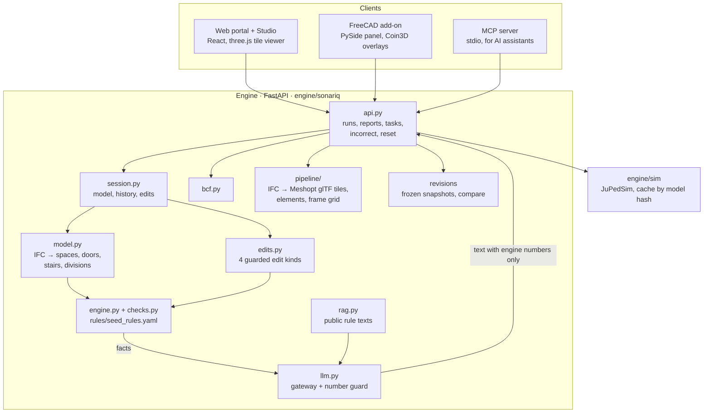

# SonarIQ architecture

**Rules decide, AI explains, engineers sign.**

## Flow of one Analyse

1. **Read**: `model.py` opens the IFC4 with IfcOpenShell and builds a light model: spaces with polygons, doors with
   clear width and fire rating, stairs with the decks they serve, fire divisions, main vertical zones.
2. **Check**: each rule in `rules/seed_rules.yaml` names a measure function in `checks.py` and a threshold. The result
   is one of Pass, Fail, Warning, **Cannot verify** (data missing, with the missing property named) or **Dormant**
   (the thing is not designed yet).
3. **Evidence**: every check carries the clause, required vs measured with units, the elements (IFC GUIDs), an evidence
   box and, where there is one, the worked formula (e.g. FSS Ch.13 stair width with persons per deck).
4. **Store**: the run is written to `data/runs/<seq>_<time>.json` with the file it read; the web Studio loads exactly
   that file (`GET /runs/<id>/ifc`), so findings are never drawn on other geometry.
5. **Review**: Incorrect finding (with a reason) is stored separately and never changes a verdict; it only leaves the
   finding out of BCF and reports. Reports freeze a run's verdicts (R-001, R-002, …).

## Change impact

Edits come from the FreeCAD Assistant (typed request → structured edit → preview → confirm). Only four edit kinds
exist, and the guard is code. After an edit the engine knows which elements and derived quantities changed (e.g.
berths in MVZ 4) and re-runs only the checks that depend on them, then lists what changed (OR-117: 7 re-run, 2 changed,
including Stair 3B, which the edit never touched).

## AI, and why it cannot set a verdict

- The gateway (`llm.py`) gets the finding JSON as facts and returns text. It is never asked for a status.
- **Number guard**: every number in the answer must appear in the facts. Otherwise the answer is discarded and the
  engine's own wording is shown (badge *Rule engine text*). Slow (> 8 s) or offline → same fallback.
- Gateways: Gemini on Vertex AI (EU) or any OpenAI-compatible server (self-hosted), chosen by env; `SONARIQ_AI=off`.
- RAG over public texts only (MSC.1/Circ.1533, ADA 2010, PVAG draft, our rule readings) supplies *Source text* and
  cited answers; it never sets a verdict.

## Simulation

`engine/sim`: JuPedSim collision-free speed model on the Deck 5 walkable area (spaces minus walls plus door openings),
stairs as capacity-limited exits with landing queues shared with timed inflows from Decks 4, 6 and 7. 500 Monte Carlo
runs per scenario (walking speed, response time per Circ.1533 Annex 3), cached by model hash + scenario hash.
Labelled on every screen as a Deck 5 sub-model for design insight, not a full-ship Circ.1533 analysis.

## Tests

- `tests/` — 82 unit tests: rules, edits and ping, BCF, review endpoints (incorrect, reports, reset), AI gateway, simulation.
- `make fc-golden` — FreeCAD headless golden path (open, analyse, colours, overlays, isolate, incorrect, BCF, fix 2).
- `make eval` — planted-violation benchmark (12/12 caught, 0 false alarms), simulation sanity, AI phrasing and
  number-guard evals; appended to `docs/EVAL.md`.

## Whole-ship viewer

`engine/sonariq/pipeline` converts the exact file of a run once (keyed by its sha-256) into Meshopt glTF tiles per
deck × discipline × level of detail, plus `elements.json` (index → IFC GlobalId) and a metadata index for the
properties card. `portal/src/viewer/ShipViewer.ts` streams the tiles in plain three.js: one draw call per tile, element
state (colour, hidden, ghosted) in one texture, GPU picking by element index, section cuts with stencil caps, and a
1-pixel depth pass for callout occlusion. Findings reach the 3D only as engine JSON (element GlobalIds + evidence
boxes); the callout card (`viewer/callout.ts`) prints only numbers that JSON contains. Details: `docs/VIEWER.md`;
decisions M1–M14 in `docs/DECISIONS.md`; speed in `docs/PERFORMANCE.md`.
