<p align="center">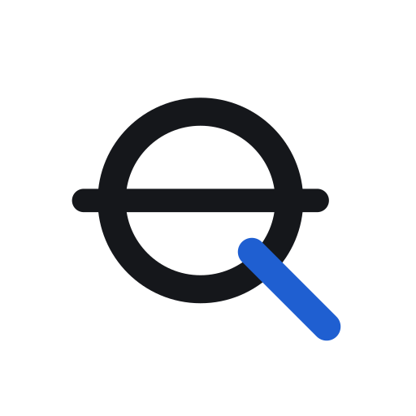</p>

<h1 align="center">SonarIQ</h1>

<p align="center"><b>AI-assisted design review for ship safety — review in the browser, fix in your CAD tool.</b></p>

<p align="center">Meyer Turku challenge · <i>Automated class and regulatory compliance checking</i> · Since AI Hackathon 2026, Turku, 6–8 Nov</p>

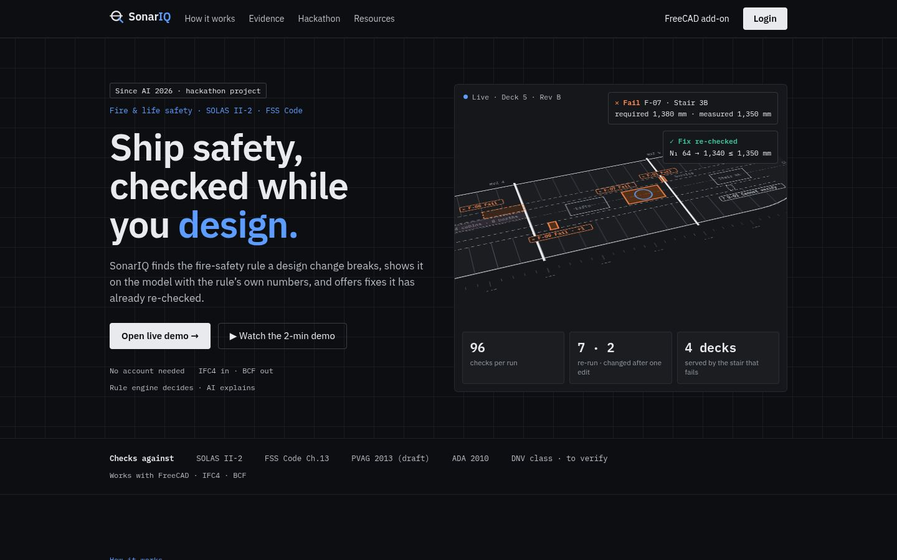

SonarIQ reads an IFC4 ship model and checks it against fire and life safety rules (SOLAS II-2, FSS Code Ch.13),
accessibility guidance and class rules. A **deterministic rule engine decides every verdict**. AI only explains it in
plain language, and a number guard throws away any AI sentence that contains a number the engine did not produce.
Engineers review, mark findings as incorrect with a reason, assign them and sign decisions.

> *How could designs be checked against class rules (e.g. DNV), SOLAS and regulations early, before conflicts
> propagate downstream?* — the challenge's guiding question.

---

## Try it in 2 minutes

**Live demo:** https://34-88-130-224.sslip.io → **Login** (no account needed).

| # | Do this | You should see |
|---|---|---|
| 1 | **Studio** → **Open model** → `deck5_revB.ifc` | The deck in x-ray grey, isometric view 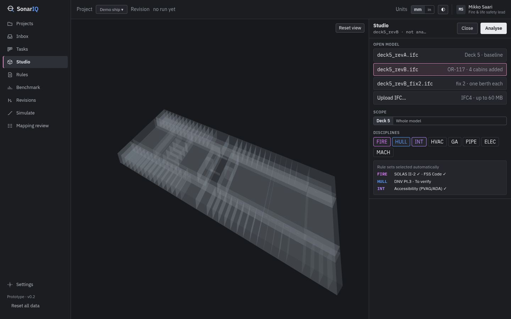 |
| 2 | **Analyse** (scope Deck 5, FIRE · HULL · INT) | 96 checks: 4 Fail · 1 Warning · 1 Cannot verify · 86 Pass · 4 Dormant; finding elements turn their status colour, the camera stays put 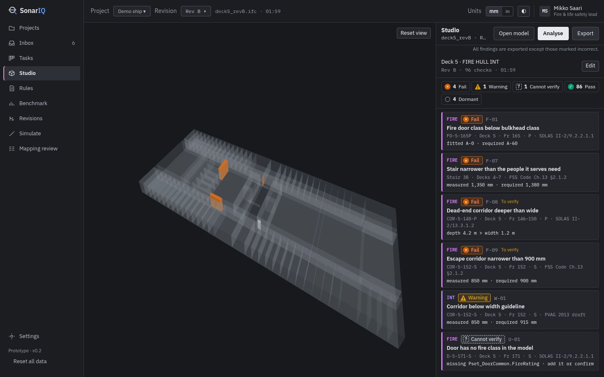 |
| 3 | Card **F-08** (dead-end corridor) | Corridor lit orange, rest ghosted, dimension labels *depth 4.2 m* and *width 1.2 m = allowed depth*, legend *Measured by rule engine · check on drawing* 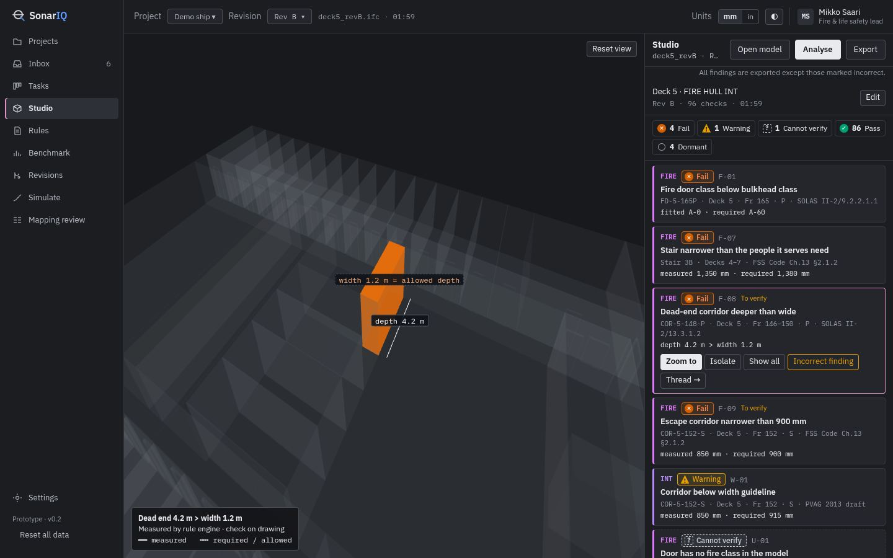 |
| 4 | **Isolate**, then **Show all** | Only the corridor, then the whole deck again 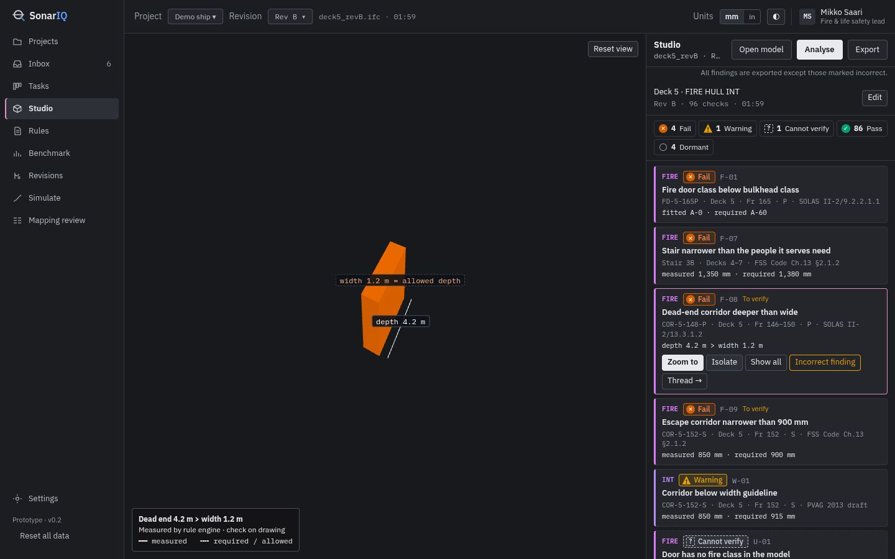 |
| 5 | **Export** | *Create report from this run?* with counts; findings marked incorrect are listed as *Left out* 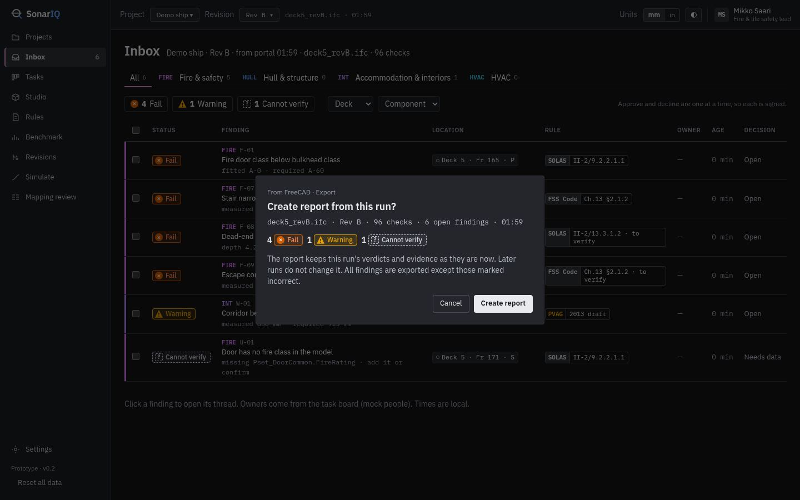 |
| 6 | **Create report** → **Inbox** and **Tasks** | Report R-001; findings with clause, measured vs required, owner and decision; task board with (mock) people 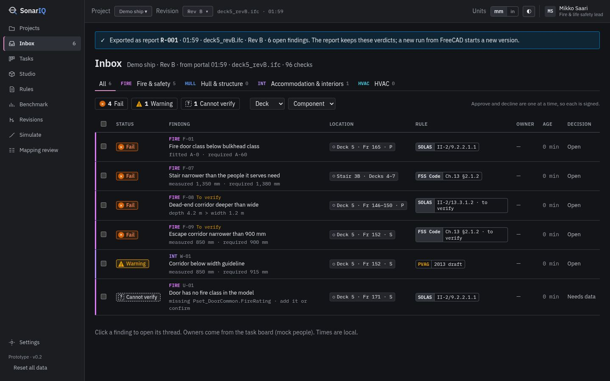 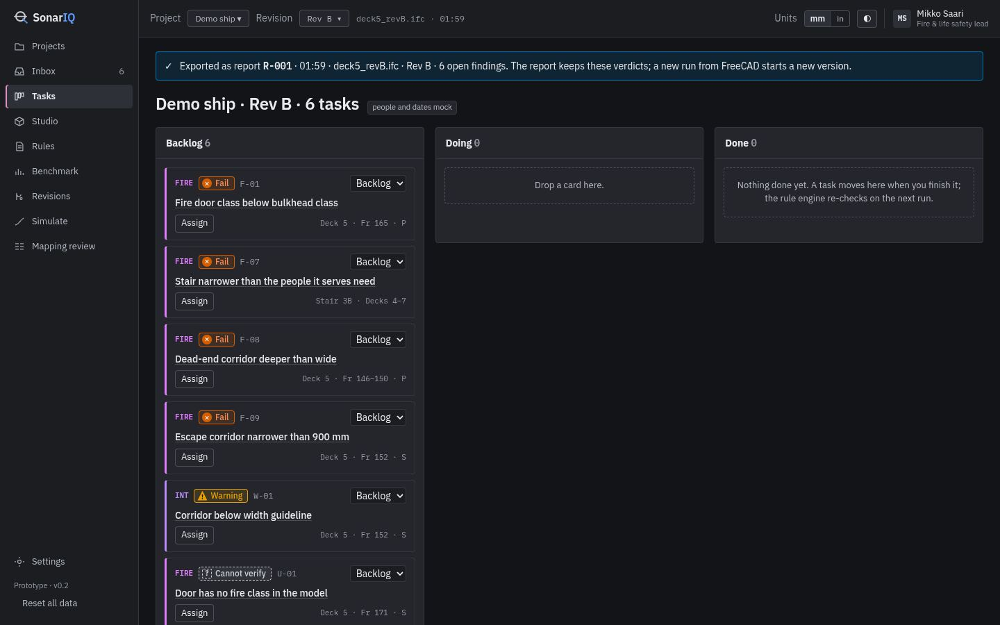 |
| 7 | **Settings → Reset all data** (or the link at the bottom of the sidebar) | Everything archived on the server, portal empty again, next report is R-001 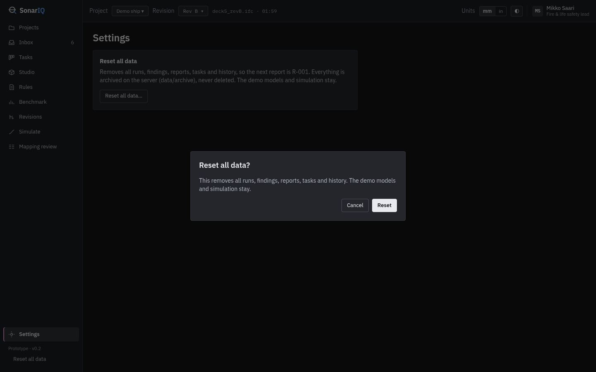 |

Also in the portal: **Simulate** (evacuation, see below), **Revisions** (every Analyse is kept as a version),
**Rules** (the rulebook with clause texts), and a finding thread with the AI explanation and signed approvals.

## Use your own model

- **IFC4** only (IFC2X3 is refused with a message), up to **60 MB** in the browser Studio (the FreeCAD add-on takes larger files).
- Sample models: https://34-88-130-224.sslip.io/downloads/models/ (`deck5_revA.ifc`, `deck5_revB.ifc`, `deck5_revB_fix2.ifc`).
- Studio → **Open model** → **Upload IFC…** → **Analyse**. The 3D always shows the exact file the run analysed.
- **Cannot verify** means the model lacks the data a rule needs (for example a door without `Pset_DoorCommon.FireRating`).
  SonarIQ never guesses and never turns missing data into a Pass; the card says which property to add.
- **Dormant** means the rule applies to something that is not designed yet (design spiral): no warning until it exists.

## Optional: inside FreeCAD

The same engine runs as a docked panel in FreeCAD 1.x: Analyse, findings light up on the 3D model, Zoom to,
Isolate / Show all, Incorrect finding, Export to the portal, and an Assistant chat that turns typed change requests
into model edits you confirm.

- **macOS (one line, about 5 minutes):**
  `curl -fsSL https://34-88-130-224.sslip.io/downloads/setup_freecad_mac.sh -o setup_sonariq.sh && bash setup_sonariq.sh`
  (asks for the engine password from the team).
- **Windows / Linux:** install FreeCAD 1.0, unzip `SonarIQ-addon.zip` from `/downloads` into FreeCAD's `Mod` folder,
  create `~/.sonariq.json` with `{"engine": "https://34-88-130-224.sslip.io/api", "user": "sonariq", "password": "<password>"}`,
  restart FreeCAD.
- Local engine instead: link `freecad_addon/SonarIQ` into the `Mod` folder and run `make api`.

## Challenge fit

| What Meyer told us | How SonarIQ meets it | Where to see it |
|---|---|---|
| 1. Compliance is checked manually, again and again, as designs evolve | Every Analyse is a stored run; re-checking is one click or automatic after an edit | Studio **Analyse**, **Revisions** |
| 2. Errors reach manufacturing where fixes are expensive; nobody can hold every rule combination | Checks run at design time, in the browser or inside the CAD tool | Studio, FreeCAD panel |
| 3. Changes propagate (owner adds passengers → cabins → stairs) | Change impact: OR-117 adds 4 cabins on Deck 5 and **Stair 3B, which nobody touched, fails**: required 1,380 mm vs measured 1,350 mm (FSS Code Ch.13 §2.1.2, worked formula shown) | Rev B **F-07**; FreeCAD Assistant edit |
| 4. "You changed this; these are the connected checks to review" | After an edit only the affected checks re-run (OR-117: 7 re-run, 2 changed) and the change is listed | FreeCAD panel ping, **Revisions** compare |
| 5. Design spiral: don't warn about areas not designed yet | **Dormant** status, separate from Pass and Fail | Studio counts (4 Dormant on Rev B) |
| 6. Many stakeholders and interpretations | **Incorrect finding** with a reason (left out of BCF and reports, undoable), signed history, Inbox decisions, Tasks with owners | Studio card, Inbox, Tasks, thread |
| 7. Accuracy first, no false positives; show a violation **and** an accepted compliant case | Deterministic rules; the same stair passes in Rev A and after fix 2 (1,340 ≤ 1,350 mm) and fails in Rev B. Benchmark: **12 planted violations, 12 caught, 0 missed, 0 false alarms** (`make eval`, [docs/EVAL.md](docs/EVAL.md)) | `deck5_revA` / `revB` / `revB_fix2` |
| 8. Interpret models and highlight **why** | Each finding: clause, required vs measured, evidence geometry, dimension overlay; AI explains in plain words and the number guard rejects any number not from the engine | Studio F-08 overlay, thread |
| 9. Run on our own servers, possibly not in the US | Live demo uses Gemini on Vertex AI in the EU. The AI gateway switches by env to any OpenAI-compatible server, e.g. an open model (Qwen) behind vLLM on your servers (`SONARIQ_AI_GATEWAY=openai`, tested against a stub, not yet against a live vLLM). Verdicts never depend on the AI and everything works with `SONARIQ_AI=off` | [DEPLOYMENT.md](DEPLOYMENT.md) |
| 10. Tools in use: NAPA, Cadmatic, CATIA, AutoCAD, PLM | Tool-agnostic: IFC4 in, BCF out (issues go back to any BIM/CAD tool). The FreeCAD add-on shows the "inside the CAD tool" pattern; adapters for your tools are roadmap | Export → BCF, FreeCAD panel |
| 11. Technical foundation over polished styling | Rule engine, evidence and tests first: 82 unit tests, a headless FreeCAD golden path, eval log | `make test`, `make fc-golden`, `make eval` |
| 12. Submission = demo + repo + docs covering deployment | This README, [DEPLOYMENT.md](DEPLOYMENT.md), [ARCHITECTURE.md](ARCHITECTURE.md), [docs/DEMO_SCRIPT.md](docs/DEMO_SCRIPT.md) | here |

## How it works

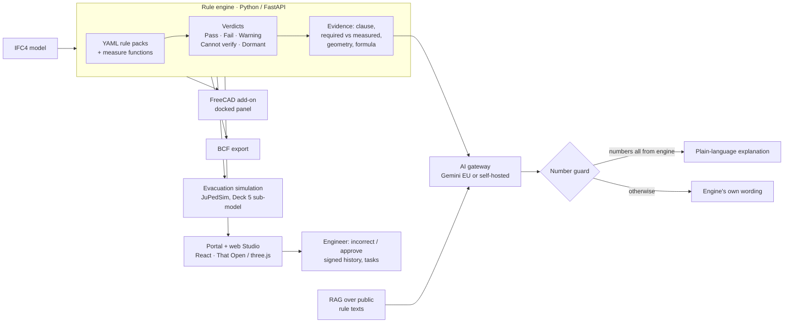

**Rules decide, AI explains, engineers sign.** The AI never sets or changes a status. Only four model edits exist
(add cabin block, move wall, set door width, set door fire class) and every edit is previewed and confirmed.
More: [ARCHITECTURE.md](ARCHITECTURE.md).

## What's checked

15 rules in [`rules/seed_rules.yaml`](rules/seed_rules.yaml) (thresholds and clause texts in YAML, measurements in code).
**Verified** = reading checked against the clause; **to verify** = runs and is labelled *To verify* on every card.

| Pack | Rules | Sources | Status |
|---|---|---|---|
| Fire (FIRE) | Fire door class vs bulkhead · MVZ bulkhead A-60 · MVZ length ≤ 40 m | SOLAS II-2/9.2.2.1.1 | verified |
| Fire (FIRE) | Stair enclosure A-0 · self-closing fire doors · glazing class | SOLAS II-2/9.2.2.3–4, 9.4.1.1.4, 9.4.1.3 | to verify |
| Escape (FIRE) | Stair width for the people it serves (persons per deck, weighted) | FSS Code Ch.13 §2.1.2 | verified |
| Escape (FIRE) | Dead-end corridors · corridor ≥ 900 mm · stair ≥ 900 mm | SOLAS II-2/13.3.1.2, FSS Ch.13 §2.1.1–2 | to verify |
| Accessibility (INT) | Corridor width guideline · door clear width 32 in | PVAG 2013 (draft), ADA 2010 §404.2.3 | verified |
| HVAC | Duct through A-class division without damper | SOLAS II-2/9.7 | to verify |
| Class (HULL) | Deck plate thickness · OCX stiffeners | DNV-RU-SHIP Pt.3 (to confirm) | to verify (placeholders) |

Coming: more DNV rules once readings are confirmed, structural checks from OCX, adapters for NAPA/Cadmatic exports.

## Simulation

Portal → **Simulate** opens four precomputed 500-run scenarios in one click (Rev B night baseline p95 12:32;
Stair 3B out p95 12:37 with the longest queue moving to Stair 3A; fire what-if with 60 people walking through smoke and
p95 unchanged; Rev B vs fix 2 side by side). JuPedSim on the Deck 5 walkable area read from the IFC, with stair
inflows from Decks 4, 6 and 7. Every result says: *Deck 5 sub-model with inflows from Decks 4, 6, 7 · design insight,
not a full-ship Circ.1533 analysis.* Details: [docs/SIMULATE.md](docs/SIMULATE.md).

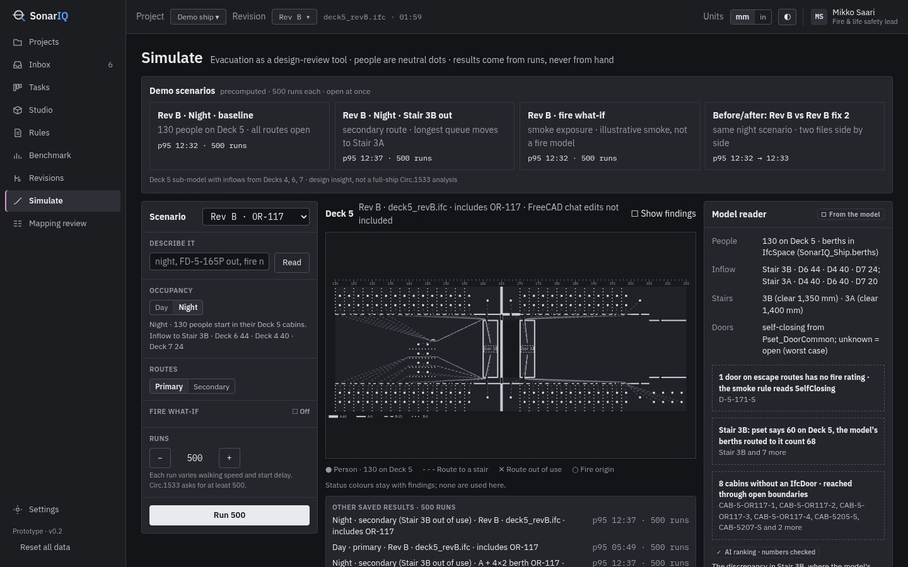

## Deployment

See **[DEPLOYMENT.md](DEPLOYMENT.md)**: single VM (what the live demo runs), on-premises path, switching the AI to a
self-hosted model or off, and notes for Red Hat OpenShift AI.

## Tech stack, layout, run locally, tests

Python 3.11 (FastAPI, IfcOpenShell, Shapely, NetworkX, JuPedSim, Google Gen AI SDK) · React + Vite + TypeScript,
That Open Components / three.js, d3 · FreeCAD 1.x (PySide, Coin3D) · Caddy · MCP server.

```
engine/sonariq/   rule engine, API (api.py), session, BCF, AI gateway (llm.py), RAG, chat edits
engine/sim/       evacuation simulation (JuPedSim), fixes explorer
rules/            YAML rule packs
portal/           React portal + web Studio
freecad_addon/    FreeCAD panel (SonarIQ)
scripts/          deploy, demo reset/restore, precompute, eval
tests/            unit tests + headless FreeCAD golden path
docs/             spec, decisions, eval log, demo script, screenshots
design/           design references and brand (logos in design/brand)
```

```bash
curl -LsSf https://astral.sh/uv/install.sh | sh      # Python 3.11 + deps (Node.js 20+ for the portal)
make setup          # uv sync + portal npm install
make test           # unit tests (82)
make api-sim        # engine on http://127.0.0.1:8765 with Simulate
make portal         # portal on http://localhost:5173
make fc-golden      # FreeCAD headless golden path (needs FreeCAD + xvfb)
make eval           # rules benchmark, simulation sanity, AI evals -> docs/EVAL.md
```

## Limits (honest)

- Rules marked **to verify** (including all DNV class rules) have not been signed off by a class society; SonarIQ is not class approved.
- Simulation is a **Deck 5 sub-model with inflows from Decks 4, 6, 7** — design insight, not a full-ship MSC.1/Circ.1533 analysis.
- The real-ship RCRV model (90,331 objects) is converted to IFC but too heavy for FreeCAD; it is used in the portal only.
- **No user authentication** in the prototype: the portal is public, the API sits behind a demo key and basic auth.
- The self-hosted AI path is implemented and unit-tested, not yet run against a live vLLM server.

## Since AI submission checklist

- [ ] Demo video ≤ 3 min — `[video link]`
- [x] Code repository — https://github.com/ermiappz/sonariq (private)
- [ ] Source .zip — `[attach from GitHub: Code → Download ZIP]`
- [x] Tagline — *AI-assisted design review for ship safety — review in the browser, fix in your CAD tool.*
- [x] Short description — first paragraph of this README
- [x] Technologies used — see *Tech stack*
- [x] AI tools disclosure — built with **Claude Code** and **Claude Design**; runtime AI: **Gemini on Vertex AI (EU)** for explanations only
- [x] Prior-work statement — built during the hackathon (6–8 Nov 2026); open-source dependencies are listed in `pyproject.toml` and `portal/package.json`
- [ ] IP terms accepted — `[confirm on the submission form]`
- [x] Optional: Red Hat / OpenShift AI deployment notes — [DEPLOYMENT.md](DEPLOYMENT.md#red-hat-openshift-ai)

## Team

**SonarIQ** — ermiappz
